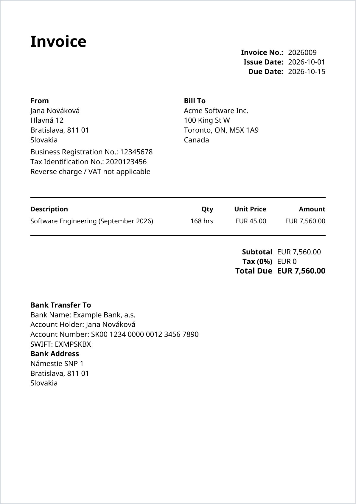

# picoinvoice

A tiny command-line tool that turns a YAML file and a number of hours into a clean,
one-page PDF invoice. Made for freelancers who bill the same client every month.

<p align="center">
  <a href="docs/sample-invoice.pdf"></a>
</p>

```console
$ picoinvoice --hours 168

Invoice summary
Total hours: 168 h
Hourly rate: EUR 45.00
Daily rate (8h): EUR 360.00
Dates: 2026-09-01 to 2026-09-30

Invoice generated: /Users/jana/Documents/Invoices/2026009.pdf
```

- One self-contained binary for macOS and Linux. The fonts are built in.
- Your details live in one YAML file, `~/.config/picoinvoice.yml`.
- Invoices are numbered automatically: `2026001`, `2026002`, … starting again each year.
- Full Unicode support for names and addresses (Noto Sans).

## Install

With [mise](https://mise.jdx.dev):

```sh
mise use -g github:klevo/picoinvoice
```

Or download the archive for your system from the
[latest release](https://github.com/klevo/picoinvoice/releases/latest), unpack it and
put `picoinvoice` somewhere on your `PATH`. Builds are available for macOS (Apple
silicon and Intel) and Linux (arm64 and x86_64, statically linked). Each archive
comes with a build provenance attestation you can check with
`gh attestation verify <archive> --repo klevo/picoinvoice`.

Or build it from source with Rust:

```sh
cargo install --locked --git https://github.com/klevo/picoinvoice
```

## Usage

```sh
picoinvoice [--hours HOURS] [--date YYYY-MM-DD] [--config PATH]
```

| Option | Default | |
|---|---|---|
| `--hours` | `default_hours` from the config, or 160 | Hours billed. |
| `--date` | today | Issue date. The invoice bills the month before it. |
| `--config` | `$XDG_CONFIG_HOME/picoinvoice.yml`, or `~/.config/picoinvoice.yml` | Config file to use. |

Each invoice has a single line item: the configured description followed by the
billed month, e.g. `Software Engineering (September 2026)`, with the hours as the
quantity. Payment is due `payment_days` after the issue date.

The PDF is saved to the config's `output` folder as `{number}.pdf`. The number is the
year followed by three digits, one higher than the highest invoice of that year already
in the folder, so the first invoice of 2027 is `2027001`. Other files in the folder are
ignored. picoinvoice never overwrites a file: if the target already exists, it exits
with an error and leaves the file alone.

## Configuration

Copy [`examples/picoinvoice.yml`](examples/picoinvoice.yml) to
`~/.config/picoinvoice.yml` and fill in your details:

```yaml
output: ~/Documents/Invoices

from:
  name: Jana Nováková
  address:
    street: Hlavná 12
    city: Bratislava
    postal_code: 811 01
    country: Slovakia
  registration_number: "12345678"
  tax_number: "2020123456"
  notes:
    - Reverse charge / VAT not applicable
  bank_details:
    bank_name: Example Bank, a.s.
    account_holder_name: Jana Nováková
    account_number: SK00 1234 0000 0012 3456 7890
    swift_code: EXMPSKBX
    address:
      street: Námestie SNP 1
      city: Bratislava
      postal_code: 811 01
      country: Slovakia

bill_to:
  name: Acme Software Inc.
  address:
    street: 100 King St W
    city: Toronto
    province: "ON"
    postal_code: M5X 1A9
    country: Canada

item:
  description: Software Engineering
  unit_price: EUR 45.00

payment_days: 14
default_hours: 160
```

| Key | Required | |
|---|---|---|
| `output` | yes | Folder for the invoices. `~` expands to your home folder; a relative path is relative to the current folder. |
| `from.name` | yes | Your name or company name. |
| `from.address` | no | `street`, `city`, `province`, `postal_code` and `country`, all optional. City, province and postal code share one line. |
| `from.registration_number` | no | Printed as "Business Registration No.". |
| `from.tax_number` | no | Printed as "Tax Identification No.". |
| `from.notes` | no | Extra lines under your details, such as a VAT note. |
| `from.bank_details` | no | `bank_name`, `account_holder_name`, `account_number`, `swift_code` and `address`, all optional. Without it there is no payment section. |
| `bill_to.name` | yes | The client. |
| `bill_to.address` | no | Same fields as `from.address`. |
| `item.description` | yes | What you bill for. The billed month is appended. |
| `item.unit_price` | yes | Hourly rate: a currency and an amount, like `EUR 45.00` or `USD 95.50`. |
| `payment_days` | no | Days until payment is due. Default 14. |
| `default_hours` | no | Hours billed when `--hours` is not given. Default 160. |

Amounts are printed with comma thousands separators and two decimals
(`EUR 7,560.00`). Tax is always 0%. Unknown keys are an error, so typos don't go
unnoticed.

## Development

```sh
cargo test        # or: mise run test
mise run lint     # rustfmt and clippy, as CI runs them
```

The tests need [poppler](https://poppler.freedesktop.org) (`brew install poppler`, or
`apt-get install poppler-utils`). `tests/reference.rs` compares generated invoices
with the reference PDFs in [`assets/invoices/`](assets/invoices/), reading both with
poppler: every word must be within 0.5pt of the reference and the rendered pages must
be nearly identical.

After a layout change, regenerate the README sample with `mise run sample` (needs
poppler and ImageMagick); a test fails while it is out of date.

### Releasing

```sh
mise run release 1.2.0
```

This sets the version in `Cargo.toml`, tags `v1.2.0` and pushes it. The
[Release workflow](.github/workflows/release.yml) then builds the binaries, attests
them and publishes the GitHub release. CI must have passed for the commit first.

## License

[MIT](LICENSE). The bundled Noto Sans fonts are under the
[SIL Open Font License](assets/fonts/OFL.txt).
